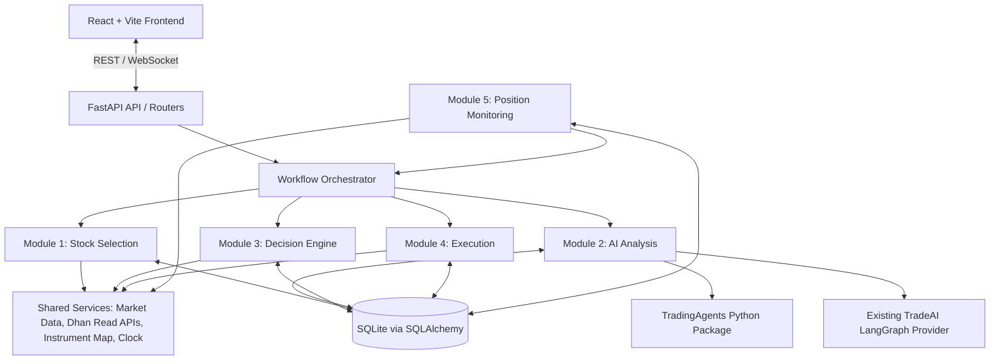

# 01 — System Architecture Specification

## 1. Architecture style

Use a **modular monolith**:

- One FastAPI application.
- One Python process in the initial SQLite deployment.
- Five business modules inside `backend/app/modules/`.
- Direct Python service/function calls between modules.
- Pydantic models for module contracts.
- SQLAlchemy repositories for persistence.
- One orchestration layer to coordinate full workflows.
- One shared configuration, market-data, instrument-mapping, database and logging layer.

Do not create a separate FastAPI service or virtual environment for TradingAgents in the agreed target architecture. Install the pinned `tradingagents` package in the single backend environment after the dependency compatibility gate passes. Module 2 imports the package and calls its documented Python API. If dependency resolution or legacy regression tests fail, stop and resolve compatibility before proceeding; do not silently split the architecture into microservices.

## 2. Logical architecture



The diagram shows logical responsibilities. The modules do not make HTTP requests to one another. The arrows between modules represent in-process calls using documented service methods and typed objects.

## 3. Communication rules

### Allowed

- Frontend → FastAPI router: HTTP REST and WebSocket for live dashboard updates.
- Router → application/workflow service: Python function call.
- Workflow service → module service: Python function call with Pydantic DTO.
- Module service → repository: Python call using SQLAlchemy session.
- Module service → shared provider: Python call.
- Module 2 → TradingAgents: documented Python import and `.propagate()` call.
- Module 4 → Dhan service/SDK: existing Dhan integration.

### Not allowed

- Module-to-module HTTP calls.
- Direct imports of another module's repository or private implementation.
- Circular imports or circular service dependencies.
- Module 2 calling Module 4 or Dhan order-placement methods.
- Module 3 importing TradingAgents-specific classes or reading raw LangGraph state.
- Module 5 placing broker orders directly.
- API routers containing strategy, risk or broker logic.
- Multiple modules updating the same table without a clear repository owner.

### Service boundary rule

Each module exposes a small public service interface. Other modules may call only that interface and shared contracts. Internal files (`repositories.py`, provider internals, strategy internals) are private to the module.

## 4. Target folder structure

This is the proposed target. Move existing files gradually; do not perform a destructive big-bang refactor.

```text
TradeAI/
├── frontend/                         # Existing React + Vite app
├── backend/
│   ├── app/
│   │   ├── main.py                   # Single FastAPI application
│   │   ├── api/v1/                   # Frontend-facing routers only
│   │   ├── modules/
│   │   │   ├── stock_selection/
│   │   │   │   ├── __init__.py
│   │   │   │   ├── README.md
│   │   │   │   ├── schemas.py
│   │   │   │   ├── service.py
│   │   │   │   ├── repository.py
│   │   │   │   └── providers/        # manual.py now; scanners later
│   │   │   ├── ai_analysis/
│   │   │   │   ├── __init__.py
│   │   │   │   ├── README.md
│   │   │   │   ├── schemas.py
│   │   │   │   ├── service.py
│   │   │   │   ├── repository.py
│   │   │   │   ├── profiles.py
│   │   │   │   ├── provider_registry.py
│   │   │   │   ├── result_mapper.py
│   │   │   │   ├── report_storage.py
│   │   │   │   └── providers/
│   │   │   │       ├── base.py
│   │   │   │       ├── tradingagents_provider.py
│   │   │   │       └── legacy_langgraph_provider.py
│   │   │   ├── decision_engine/
│   │   │   │   ├── __init__.py
│   │   │   │   ├── README.md
│   │   │   │   ├── schemas.py
│   │   │   │   ├── service.py
│   │   │   │   ├── signal_evaluator.py
│   │   │   │   ├── entry_exit_validator.py
│   │   │   │   ├── position_sizer.py
│   │   │   │   ├── risk_validator.py
│   │   │   │   └── strategies/
│   │   │   ├── execution/
│   │   │   │   ├── __init__.py
│   │   │   │   ├── README.md
│   │   │   │   ├── schemas.py
│   │   │   │   ├── service.py
│   │   │   │   ├── order_reconciler.py
│   │   │   │   └── brokers/         # paper.py first, dhan.py adapter
│   │   │   └── position_monitoring/
│   │   │       ├── __init__.py
│   │   │       ├── README.md
│   │   │       ├── schemas.py
│   │   │       ├── service.py
│   │   │       └── rules/
│   │   ├── workflows/               # In-process orchestration functions
│   │   ├── shared/                  # DB, config, market data, instruments, clock, logs
│   │   ├── jobs/                    # DB-backed analysis worker/recovery
│   │   └── harness/                 # Existing harness; no duplicate scheduler
│   ├── migrations/                  # Alembic migrations
│   ├── data/                        # Gitignored: tradeai.db + TA sidecar stores
│   ├── scripts/
│   ├── tests/
│   │   ├── structure/
│   │   ├── unit/modules/
│   │   │   ├── stock_selection/
│   │   │   ├── ai_analysis/
│   │   │   ├── decision_engine/
│   │   │   ├── execution/
│   │   │   └── position_monitoring/
│   │   ├── integration/module_boundaries/
│   │   ├── integration/workflows/
│   │   ├── regression/
│   │   └── end_to_end/
│   ├── pytest.ini
│   ├── requirements.in
│   ├── requirements.txt              # Resolved/locked dependency set
│   └── .env.example
├── docs/
│   └── implementation-status.md      # Add at coding start; track module gates
└── README.md
```

## 5. Existing-code migration rules

The current backend README documents these areas. Verify exact local paths before moving them:

| Existing capability | Target ownership | Migration approach |
|---|---|---|
| Existing manual/top-mover stock analysis and market-data selection | `modules/stock_selection` plus `shared/market_data` | Wrap existing behavior first; split providers later. |
| Existing conversational LangGraph agent | Keep as a conversational capability; adapt to Module 2 only if it can return the common analysis contract | Do not force conversational chat into the stock-analysis provider interface. |
| Existing technical indicator service | `shared/market_data` or `shared/analytics` | Reuse calculations; avoid duplicating RSI/MACD/etc. |
| Dhan client and symbol/security-ID mapping | `shared` or `modules/execution/brokers/dhan.py` | Preserve one authenticated client and existing wrappers. |
| Dhan order service and paper/live branch | Module 4 | Keep current guardrails and trade logging; expose a clean service interface. |
| Guardrail service | Module 3 policy layer and Module 4 final execution gate | Module 3 makes the decision; Module 4 re-checks mandatory execution guardrails. |
| Trading harness/strategy coordinator | Workflow/runtime infrastructure | Reuse; do not introduce a second scheduler or order pipeline. |
| Watchdog | Module 5 | Preserve deterministic checks; change AI reassessment to call Module 2 through the workflow. |
| Existing API routes | `api/v1` | Keep current routes backward-compatible while delegating to new services. |

## 6. Runtime and concurrency

- Start with one Uvicorn worker while SQLite is the primary store and the in-process scheduler/worker runs.
- Use a database-backed job table for long-running AI analysis. Do not rely solely on FastAPI `BackgroundTasks` for work that must survive restarts.
- Run TradingAgents' synchronous `.propagate()` call in a worker thread using `asyncio.to_thread()` or Starlette's threadpool helper. Never block the event loop.
- Limit simultaneous TradingAgents runs with a configurable semaphore. Start with one concurrent analysis until provider quotas, graph-instance safety and SQLite writes are tested.
- Use a database-backed `PENDING → RUNNING → COMPLETED/FAILED` state machine and retry policy. On startup, recover jobs left `RUNNING` by a crashed process according to retry limits.
- Do not run multi-worker Uvicorn against one SQLite file with an in-process job worker. Revisit worker topology when moving to PostgreSQL and an external queue.
- The existing five-second harness tick must not launch a new multi-agent analysis every tick. Trigger analyses on explicit requests or controlled events and cache/reuse still-valid analysis results.

## 7. Configuration principles

- All settings come from one typed settings object (Pydantic Settings).
- Store secrets in environment variables, never in source code or SQLite rows.
- Keep provider configuration separate from strategy/risk configuration.
- Use an explicit timezone setting (`Asia/Kolkata`) for market sessions, logs and scheduled work.
- Default `TRADING_MODE=PAPER`, `LIVE_TRADING_ENABLED=false`, `HARNESS_AUTO_START=false`.
- Expose feature flags for scanner providers and AI providers.

## 8. Architecture acceptance criteria

- The backend starts as one FastAPI application.
- All five modules are importable packages and expose service interfaces.
- No internal module makes an HTTP request to another module.
- Module 3 has no import dependency on TradingAgents.
- API routers delegate to services and contain no business logic.
- The current Dhan client is not duplicated.
- SQLite can persist application state across restart.
- The full test suite runs with one worker and paper mode.


## 9. Structure-first refactor rules

The first code-change phase is structural, not a feature rewrite.

1. Create the five module package directories, public `schemas.py` and `service.py` entry points, and module-specific test folders.
2. Create `shared/` and `workflows/` before moving code so shared capabilities have a clear owner.
3. Map every existing file to one owner in a migration inventory. Do not move a file based only on its name; inspect its imports and callers.
4. Initially use thin facades/adapters that delegate to existing code. Move implementation files only when imports and tests can be updated atomically.
5. Keep temporary compatibility wrappers at old import paths while callers are migrated. Mark them deprecated and remove them only after repository-wide search and tests confirm no references remain.
6. Do not change external API behavior, database schema or trading logic in a structure-only pull request unless the change is necessary and separately tested.
7. A structure-only phase passes only when the FastAPI app starts, all five packages import, the SQLite test database initializes, old key routes remain functional, and existing regression tests have no new failures.

## 10. Module testability requirements

Every module must expose a public service facade and be testable without launching the complete trading workflow. Tests are organized by module under `backend/tests/unit/modules/<module_name>/`. Each module must have: contract validation tests, isolated business-logic tests, repository tests when it owns persisted data, and adapter tests using fakes/mocks for external boundaries. Cross-module behavior belongs under `tests/integration/`, not in a module's unit tests. See `docs/10-structure-first-and-module-testing.md`.

## 11. TradingAgents-enhanced Module 2 capabilities

The Module 2 provider adapter may use documented TradingAgents features without editing its package: parallel analyst execution, selected analyst sets, analysis profiles, quick/deep model tiers (including separate provider settings for each tier), `PortfolioContext`, report saving including the single-page HTML report, decision-memory path configuration, opt-in graph checkpointing and its research backtest API. These are provider capabilities, not new responsibilities for Module 3.

- Store the full analysis profile and model/provider identifiers with every `AnalysisRun`.
- Pass portfolio context only from an authoritative, timestamped TradeAI account snapshot. An explicit empty positions list means a flat portfolio; omitted portfolio context must not be treated as flat.
- Configure TradingAgents memory and checkpoint directories below a dedicated `backend/data/tradingagents/` sidecar directory, separate from `tradeai.db` and isolated by environment.
- Treat TradingAgents memory outcomes as research feedback, not as actual Dhan fills or audited TradeAI P&L.
- Use TradingAgents backtesting to evaluate its research decisions; use a separate TradeAI backtester for full strategy/order/fee/slippage simulation.
- Record report path and checksum/metadata; do not place large HTML documents directly into the main SQLite row unless there is a specific reason.
